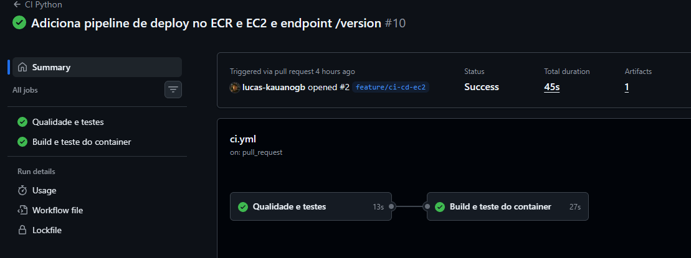
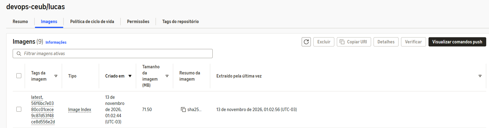
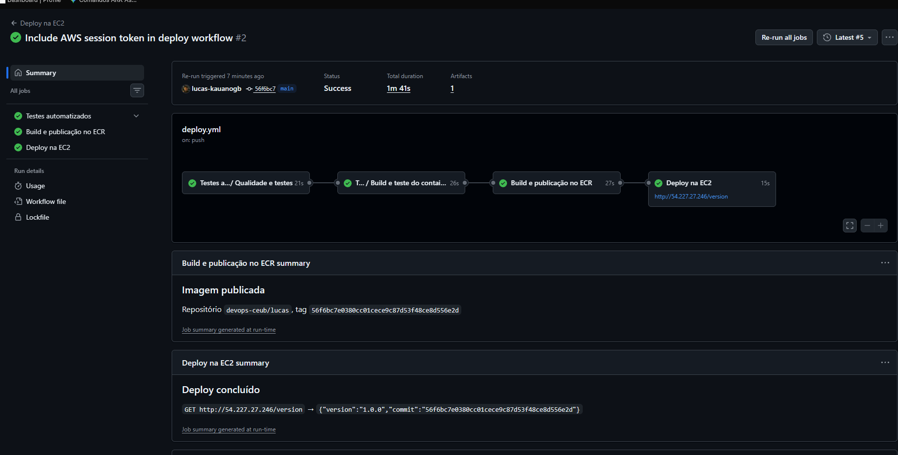
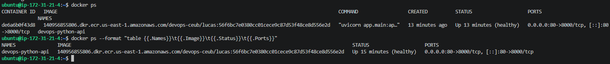
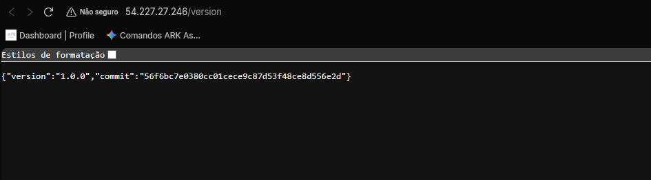
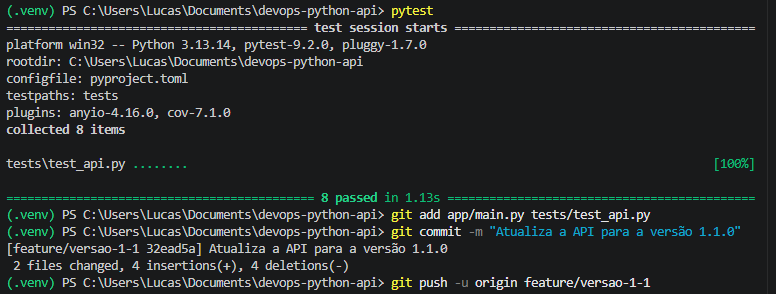
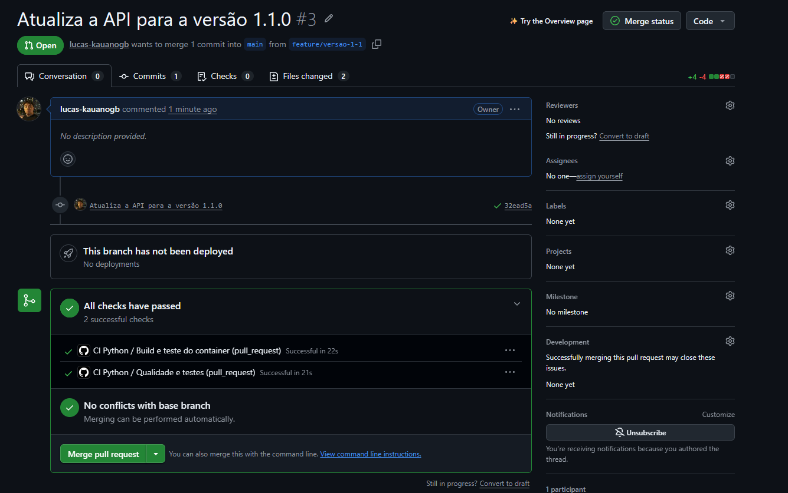
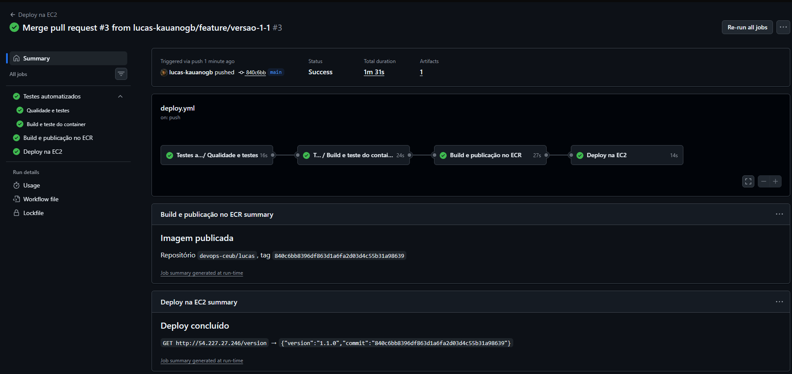
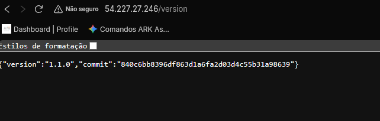

# devops-python-api — CI/CD com GitHub Actions, Docker, Amazon ECR e EC2

API HTTP de tarefas escrita em Python (FastAPI), usada para demonstrar uma esteira completa de integração e entrega contínua:

**alteração no código → branch → Pull Request → testes automatizados → merge na main → build Docker → publicação no ECR → deploy na EC2 → aplicação atualizada.**

Os dados ficam em memória para manter o foco no fluxo DevOps, sem banco de dados.

## API publicada

| Recurso | Endereço |
|---|---|
| API | <http://54.227.27.246/> |
| Versão implantada | <http://54.227.27.246/version> |
| Saúde | <http://54.227.27.246/health> |
| Documentação Swagger | <http://54.227.27.246/docs> |

> O projeto foi implantado em uma conta **AWS Academy (Learner Lab)**. A instância é desligada ao fim de cada sessão do laboratório e recebe um IP público novo ao ser religada; nesse caso, o endereço acima e a variável `EC2_HOST` precisam ser atualizados.

## Tecnologias utilizadas

| Ferramenta | Uso no projeto |
|---|---|
| Python 3.13 + FastAPI + Uvicorn | Aplicação e servidor HTTP |
| pytest + pytest-cov + httpx2 | Testes automatizados e cobertura (mínimo de 90%) |
| Ruff | Análise estática e formatação |
| Git + GitHub (branches e Pull Requests) | Versionamento e revisão |
| GitHub Actions | Pipelines de CI (`ci.yml`) e CD (`deploy.yml`) |
| Docker | Empacotamento e execução da aplicação |
| Amazon ECR — repositório `devops-ceub/lucas` | Registro privado das imagens |
| Amazon EC2 (Ubuntu, `t3.micro`) — instância `vm-deploy` | Servidor que executa o container |
| AWS IAM — role `LabRole` (via `LabInstanceProfile`) | Permissão da EC2 para baixar imagens do ECR, sem chaves no servidor |

## Estrutura do repositório

```text
.
├── .github/workflows/
│   ├── ci.yml                 # CI: valida Pull Requests (lint, testes, build do container)
│   └── deploy.yml             # CD: testes → build → push no ECR → deploy na EC2
├── app/
│   ├── __init__.py
│   └── main.py                # API FastAPI
├── docs/
│   ├── API.md
│   ├── AWS-SETUP.md           # passo a passo de ECR, IAM, EC2 e Secrets
│   ├── DOCKER.md
│   ├── GITHUB-ACTIONS.md
│   └── evidencias/            # capturas de tela da entrega
├── scripts/
│   ├── deploy-ec2.sh          # executado na EC2 pela pipeline de deploy
│   └── ec2-user-data.sh       # prepara a EC2 Ubuntu (Docker + AWS CLI)
├── tests/test_api.py          # testes automatizados
├── .dockerignore
├── .python-version
├── compose.yaml
├── Dockerfile
├── pyproject.toml             # configuração de pytest, cobertura e Ruff
└── requirements.txt           # dependências da aplicação e dos testes
```

## Endpoints

| Método | Caminho | Objetivo | Resposta esperada |
|---|---|---|---|
| GET | `/` | Apresentar a API | `200` |
| GET | `/health` | Informar saúde e versão | `200` |
| GET | `/version` | Informar versão e commit implantado | `200` |
| GET | `/tasks` | Listar tarefas | `200` |
| POST | `/tasks` | Criar uma tarefa | `201` |
| PATCH | `/tasks/{id}/done` | Concluir uma tarefa | `200` ou `404` |

## 1. Execução local

Pré-requisitos: Git e Python 3.13.

### Linux e macOS

```bash
python3 -m venv .venv
source .venv/bin/activate
python -m pip install --requirement requirements.txt
uvicorn app.main:app --reload
```

### Windows PowerShell

```powershell
py -3.13 -m venv .venv
.venv\Scripts\Activate.ps1
python -m pip install --requirement requirements.txt
uvicorn app.main:app --reload
```

Acesse <http://localhost:8000>, <http://localhost:8000/docs> e <http://localhost:8000/version>.

Verificações locais (as mesmas executadas pela CI):

```bash
ruff check .
ruff format --check .
pytest --cov=app --cov-report=term-missing
```

## 2. Docker

Construir e executar a imagem localmente:

```bash
docker build -t devops-python-api:local .
docker run --rm -d -p 8000:8000 --name devops-python-api devops-python-api:local
curl http://localhost:8000/health
docker ps
docker logs devops-python-api
docker stop devops-python-api
```

Ou com Docker Compose: `docker compose up --build`.

O `Dockerfile` usa `python:3.13-slim`, instala as dependências de `requirements.txt` durante o build, copia apenas o diretório `app`, executa como usuário sem privilégios, expõe a porta `8000`, define um `HEALTHCHECK` em `/health` e inicia a API com `uvicorn app.main:app --host 0.0.0.0 --port 8000`.

## 3. Pipeline de integração contínua (`ci.yml`)

Acionada automaticamente quando um Pull Request para a `main` é aberto ou atualizado (e manualmente pela aba Actions).

| Job | Steps |
|---|---|
| **Qualidade e testes** | checkout → setup do Python 3.13 (com cache do pip) → `pip install -r requirements.txt` → `ruff check` → `ruff format --check` → `pytest` com cobertura → upload dos relatórios (JUnit e cobertura) |
| **Build e teste do container** (`needs` do job anterior) | `docker build` → `docker run` → chamada a `/health` → logs → remoção do container |

O resultado aparece no próprio Pull Request (✔ ou ✖). Com a regra de proteção da `main` exigindo a CI aprovada, um PR com testes falhando não pode ser mergeado.

## 4. Pipeline de entrega contínua (`deploy.yml`)

Acionada a cada push na `main`, ou seja, após o merge de um Pull Request aprovado.

```text
tests ──▶ build-and-push ──▶ deploy
```

1. **`tests`** — reutiliza o `ci.yml` (`workflow_call`): exatamente os mesmos testes do PR. **Se falharem, os jobs seguintes não executam.**
2. **`build-and-push`** — autentica na AWS com as credenciais temporárias do AWS Academy guardadas em GitHub Secrets, faz login no ECR, constrói a imagem e a publica com duas tags: o **SHA do commit** (imutável, rastreável) e `latest`.
3. **`deploy`** — abre uma conexão SSH com a EC2 usando a chave guardada em Secret e executa [`scripts/deploy-ec2.sh`](scripts/deploy-ec2.sh), que:
   1. autentica o Docker da instância no ECR usando a **IAM Role** da EC2;
   2. baixa a imagem com a tag do commit;
   3. remove o container anterior;
   4. inicia o novo container (`-p 80:8000`, `--restart unless-stopped`, `APP_COMMIT=<sha>`);
   5. verifica se o container está em execução e respondendo em `/health`.

   Por fim, o runner chama `http://<EC2>/version` e confere se o commit em produção é o que acabou de ser publicado.

Nenhum comando manual é executado na instância após cada alteração.

### Segredos e permissões

| Onde | Nome | Conteúdo |
|---|---|---|
| GitHub Secret | `AWS_ACCESS_KEY_ID`, `AWS_SECRET_ACCESS_KEY`, `AWS_SESSION_TOKEN` | Credenciais temporárias da sessão do AWS Academy, usadas para enviar a imagem ao ECR |
| GitHub Secret | `EC2_SSH_KEY` | Chave privada do key pair da EC2 (`vockey`) |
| GitHub Variable | `AWS_REGION` = `us-east-1`, `ECR_REPOSITORY` = `devops-ceub/lucas`, `EC2_HOST` = IP da EC2, `EC2_USER` = `ubuntu` | Configuração não sensível |
| IAM Role da EC2 | `LabRole` (instance profile `LabInstanceProfile`) | Leitura do ECR sem chaves na instância |

Como a conta AWS Academy não permite criar usuários nem roles no IAM, foram usadas as credenciais temporárias da sessão (que expiram ao fim do laboratório) e a role pré-configurada `LabRole`. Nenhuma senha, token ou chave está versionada no repositório. O passo a passo completo está em [docs/AWS-SETUP.md](docs/AWS-SETUP.md).

## 5. Arquitetura de implantação

```text
 Desenvolvedor                         GitHub                                   AWS
┌─────────────┐  push branch   ┌──────────────────────┐
│ feature/... │ ─────────────▶ │ Pull Request → main  │
└─────────────┘                │   ci.yml (testes)    │
                               └──────────┬───────────┘
                                          │ merge
                               ┌──────────▼───────────┐   docker push   ┌──────────────────┐
                               │ deploy.yml           │ ──────────────▶ │ Amazon ECR       │
                               │ tests → build → push │                 │ (repo privado)   │
                               │ → deploy (SSH)       │                 └────────┬─────────┘
                               └──────────┬───────────┘                          │ docker pull
                                          │ SSH (chave em Secret)                │ (IAM Role)
                                          │                         ┌────────────▼─────────┐
                                          └───────────────────────▶ │ EC2 Ubuntu (vm-deploy)│
                                                                    │ container :80→:8000  │
                                                                    └────────────┬─────────┘
                                                                                 │ HTTP :80
                                                                            Usuário / navegador
```

## 6. Como verificar a versão implantada

```bash
curl http://54.227.27.246/version
# {"version":"1.1.0","commit":"840c6bb8396df863d1a6fa2d03d4c55b31a98639"}
```

- `version` é a versão declarada em `app/main.py`.
- `commit` é o SHA do commit da `main` que gerou a imagem; deve coincidir com o último commit da `main` e com a tag da imagem no ECR.

Também é possível conferir na instância (somente leitura): `docker ps` mostra a imagem `...dkr.ecr.us-east-1.amazonaws.com/devops-ceub/lucas:<sha>` em execução, com o status `healthy`.

## 7. Demonstração de atualização automática

| | Versão 1 | Versão 2 |
|---|---|---|
| Pull Request | [#2 — feature/ci-cd-ec2](https://github.com/lucas-kauanogb/devops-python-api/pull/2) | [#3 — feature/versao-1-1](https://github.com/lucas-kauanogb/devops-python-api/pull/3) |
| Commit implantado | `56f6bc7e0380cc01cece9c87d53f48ce8d556e2d` | `840c6bb8396df863d1a6fa2d03d4c55b31a98639` |
| Tag da imagem no ECR | `56f6bc7e0380...` | `840c6bb8396d...` |
| `GET /version` | `{"version":"1.0.0","commit":"56f6bc7..."}` | `{"version":"1.1.0","commit":"840c6bb..."}` |

Fluxo da versão 2: branch `feature/versao-1-1` → alteração da versão e da mensagem de `/` → `pytest` local (8 testes aprovados) → commit e push → PR #3 com a CI aprovada → merge na `main` → pipeline **Deploy na EC2** executada automaticamente → `/version` passou a responder `1.1.0`. Nenhum comando foi executado manualmente na instância para essa atualização.

## 8. Evidências

### Integração contínua



### Imagem publicada no Amazon ECR



### Pipeline de deploy



### Container em execução na EC2



### Aplicação acessível — versão 1



### Testes locais da versão 2



### Pull Request da versão 2



### Deploy automático da versão 2



### Aplicação atualizada — versão 2



Histórico completo das execuções: aba [Actions](https://github.com/lucas-kauanogb/devops-python-api/actions) do repositório.

## Referências

- [GitHub Actions: criar e testar Python](https://docs.github.com/pt/actions/tutorials/build-and-test-code/building-and-testing-python)
- [Reutilizando workflows](https://docs.github.com/pt/actions/sharing-automations/reusing-workflows)
- [aws-actions/configure-aws-credentials](https://github.com/aws-actions/configure-aws-credentials)
- [aws-actions/amazon-ecr-login](https://github.com/aws-actions/amazon-ecr-login)
- [Amazon ECR: enviar imagens](https://docs.aws.amazon.com/AmazonECR/latest/userguide/docker-push-ecr-image.html)
- [FastAPI](https://fastapi.tiangolo.com/)
